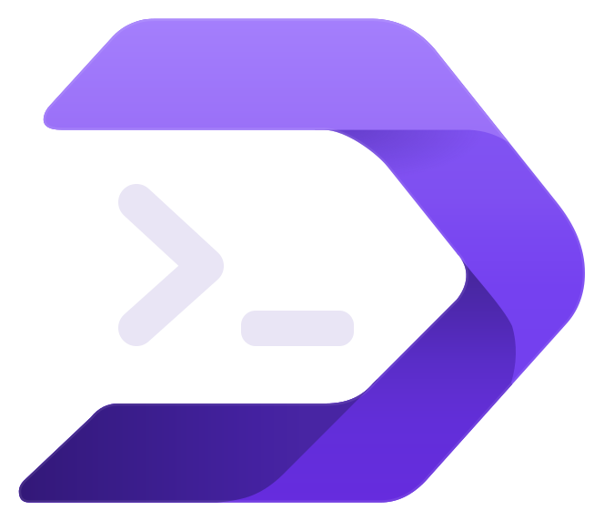

<div align="center">
  

  <h1><span style="color: #41209b;">JS</span>Dash</h1>

  <p>
    A lightweight, cross-platform JavaScript playground.
    <br />
    Write, run, and experiment with JavaScript using multiple Node.js versions.
  </p>

  <p>
    
    
    
    
    
  </p>
</div>

---

## Overview

**JSDash** is a lightweight desktop application designed for writing and executing JavaScript in a simple, focused environment.

Built with Tauri, React, TypeScript, and Rust, it combines a modern code editor with a native execution environment powered by Node.js.

JSDash aims to provide a fast and straightforward JavaScript playground without requiring a separate Node.js installation on the user's system.

## Features

- **Monaco Editor** — A powerful code editor with syntax highlighting and developer-friendly editing features.
- **Multiple Node.js Versions** — Switch between different Node.js versions to test compatibility and experiment with different runtime environments.
- **Cross-platform** — Designed to run on Windows, Linux, and macOS.
- **Lightweight** — Built with Tauri for a smaller application footprint.
- **Native Execution** — Execute JavaScript using Node.js runtimes managed by JSDash.
- **Modern Interface** — A clean and minimal environment focused on the coding experience.

## Tech Stack

| Technology                                                  | Purpose                                     |
| ----------------------------------------------------------- | ------------------------------------------- |
| [Tauri](https://tauri.app/)                                 | Desktop application framework               |
| [React](https://react.dev/)                                 | User interface                              |
| [TypeScript](https://www.typescriptlang.org/)               | Application development                     |
| [Rust](https://www.rust-lang.org/)                          | Native functionality and process management |
| [Monaco Editor](https://microsoft.github.io/monaco-editor/) | Code editing                                |
| [Node.js](https://nodejs.org/)                              | JavaScript runtime                          |

## Getting Started

### Prerequisites

Make sure you have the following tools installed:

- [Node.js](https://nodejs.org/) and npm
- [Rust](https://www.rust-lang.org/tools/install)
- [Tauri prerequisites](https://v2.tauri.app/start/prerequisites/)

### Installation

Clone the repository:

```bash
git clone https://github.com/santiagodevx/jsdash.git
cd jsdash
```

Install dependencies:

```bash
npm install
```

### Development

Start the development environment:

```bash
npm run tauri dev
```

### Build

Build the desktop application:

```bash
npm run tauri build
```

The generated installers and application bundles will be available in the Tauri build output directory.

## Project Structure

```text
jsdash/
├── public/
├── src/
│   └── features/
│       └── editor/
│           ├── components/
│           ├── config/
│           ├── context/
│           └── hooks/
│
├── src-tauri/
│   ├── binaries/
│   ├── src/
│   └── tauri.conf.json
│
├── package.json
└── README.md
```

## Roadmap

JSDash is currently under active development.

- [x] Initial desktop application setup
- [x] Monaco Editor integration
- [x] Custom editor theme
- [x] Editor state management with React Context
- [ ] JavaScript execution engine
- [ ] Node.js runtime integration
- [ ] Multiple Node.js version management
- [ ] Execution output and console
- [ ] Execution cancellation and process management
- [ ] Windows support
- [ ] Linux support
- [ ] macOS support

## Contributing

Contributions, ideas, and suggestions are welcome.

If you want to contribute:

1. Fork the repository.
2. Create a feature branch.
3. Make your changes.
4. Commit your changes.
5. Open a Pull Request.

## License

This project is licensed under the [MIT License](LICENSE).

---

<div align="center">
  <p>
    <strong>JSDash</strong>
    <br />
    <sub>A simple place to write and run JavaScript.</sub>
  </p>
</div>
